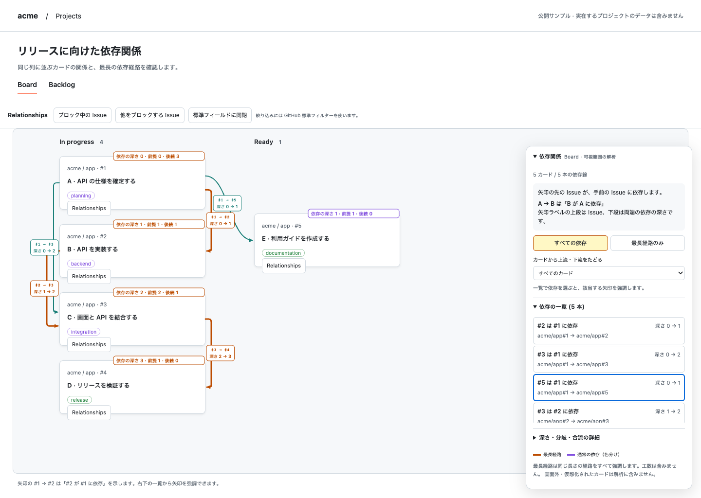

# GitHub Projects Dependency Visualizer

GitHub Projects の **Board・Table・Roadmap** で、Issue の依存関係と複雑さを確認する Chrome 拡張機能です。GitHub のネイティブな依存関係を読み取り、**前提 → 後続（ブロック元 → ブロック先）** の矢印と解析パネルを各 View に重ねて表示します。

Projects 内から依存・親子関係を編集し、GitHub 標準のフィルターで絞り込めます。依存の表示用フィールドを Project に同期すると、標準のフィールド選択や並べ替えにも使えます。

- **依存する Issue と深さを表示**: 線の上段に `#1 → #2`、下段に `深さ 0 → 1` のように両端の Issue と依存の深さを表示します。「依存の一覧」の `#2 は #1 に依存` を選ぶと、その線と両端カードのバッジを強調できます。一覧でも両端の深さを確認できます。
- **重なる線を分離**: 接続点とレーンを分散し、同じ列のカード間の線は横へ迂回します。
- **各 View で依存関係を追跡**: Board のカード、Table のタイトルセル、Roadmap のタイムライン上のバーを接続します。Roadmap では、バーが見えない場合は同じ Issue の可視タイトルセルへ接続します。
- **依存の深さと複雑さを表示**: 解析パネルの「深さ・分岐・合流の詳細」を開くと、依存の最大深さ・分岐数・合流数と数値の定義を確認できます。Issue を選ぶと、依存の深さ・直接の前提数と後続数・下流への影響先件数を表示し、上流・下流の依存を強調します。Board ではカード上にも依存の深さと前提・後続の数を小さなバッジで表示します。
- **最長経路を追跡**: 最長の依存経路を強調し、「最長経路のみ」で絞り込めます。同じ長さの最長経路が複数あれば、すべてを対象にします。
- **循環を警告**: 循環している関係を赤い破線で表示します。循環がある間は依存の深さ・最長経路を算出しません。

**解析対象は画面に表示されている Issue 間の関係です。最長経路は依存関係の辺数で計算し、期間・工数を使うクリティカルパスではありません。** Roadmap の日付やバーの長さは最長経路の計算に使いません。取得中は暫定値、API の取得失敗や件数上限がある場合は不完全な解析として表示します。



[Dark テーマの表示例](docs/dependency-analysis-dark.png)

[Table の表示例](docs/table-view.png) / [Roadmap の表示例](docs/roadmap-view.png)

## インストール

Chrome 114 以降を使用します。

1. [Releases](https://github.com/krhrtky/github-projects-dependency-visualizer/releases) を開き、`github-projects-dependency-visualizer-<version>-chrome.zip` をダウンロードして展開します。GitHub が自動生成する `Source code (zip)` は配布用の拡張機能ではありません。
2. Chrome で `chrome://extensions` を開き、「デベロッパー モード」を ON にします。
3. 「パッケージ化されていない拡張機能を読み込む（Load unpacked）」を押し、**`manifest.json` が直下にある展開フォルダ**を選びます。ZIP ファイル自体は選択しません。
4. 既に開いている GitHub タブを再読み込みします。

[GitHub Actions](https://github.com/krhrtky/github-projects-dependency-visualizer/actions/workflows/ci.yml) の成功した実行からも、`github-projects-dependency-visualizer-chrome-...` Artifact をダウンロードできます。Artifact の ZIP も直下に `manifest.json` を含むため、展開後は同じ手順で読み込めます。Actions の Artifact ダウンロードには GitHub へのログインが必要です。

更新時は読み込んだフォルダの内容を新しい ZIP の内容で置き換え、拡張管理画面で再読み込みした後、GitHub タブを再読み込みしてください。認証情報は再入力が必要です。Chrome の公式手順は [Load an unpacked extension](https://developer.chrome.com/docs/extensions/get-started/tutorial/hello-world#load-unpacked) を参照してください。

## 使い方

1. 対象の GitHub Project の **Board・Table・Roadmap** のいずれかを開きます。
2. 拡張機能の Popup に Fine-grained PAT または PAT (classic) を入力し、「PAT を設定」を押します。
3. 「依存関係を表示」を ON にします。初期値は OFF です。
4. 画面右下の解析パネルにある「依存の一覧」で、`#2 は #1 に依存` のような文を確認します。一覧は初期表示で開いており、行を選ぶと該当する線と両端カードのバッジを強調します。「強調を解除」で全体の表示へ戻せます。Issue の選択や「最長経路のみ」でも絞り込めます。依存の最大深さ・分岐・合流は「深さ・分岐・合流の詳細」を開いて確認します。パネル全体は見出しから折りたためます。
5. GitHub 上で依存関係を変更した後や、取得エラーの原因を解決した後は **Refresh** を押します。
6. **Logout** は PAT と関係キャッシュを削除し、表示を OFF にします。

| View | 線の接続先と数値の確認方法 |
| --- | --- |
| Board | カードを接続します。カード上のバッジと解析パネルで依存の深さ・前提数・後続数を確認できます。 |
| Table | 各行の Issue タイトルセルを接続します。依存の深さ・前提数・後続数・下流への影響数は解析パネルの Issue 選択で確認します。 |
| Roadmap | 同じ Issue の可視バーを優先します。バーがない場合や表示期間外の場合は、可視タイトルセルに接続します。数値は解析パネルの Issue 選択で確認します。 |

Table・Roadmap の行には数値バッジを重ねません。タイトルや日付の読みやすさを保ち、Issue ごとの数値は解析パネルに表示します。タイトルセルもバーも見えない Issue は接続・解析の対象外です。

| 表示 | 意味 |
| --- | --- |
| 依存の深さ | 可視範囲で前提のない Issue を 0 とした、そこまでの最長経路に含まれる接続数。例: A → B → C では A が 0、B が 1、C が 2 |
| 前提 | その Issue を直接ブロックする Issue 数 |
| 後続 | その Issue が直接ブロックする Issue 数 |
| 下流の影響先 | 直接・間接にブロックする、重複を除いた Issue 数。自分自身を除く |
| 分岐カード／項目 | 後続が 2 件以上ある Issue 数 |
| 合流カード／項目 | 前提が 2 件以上ある Issue 数 |
| 依存の最大深さ | 可視範囲のグラフに含まれる最長経路の辺数 |
| `#1 → #2` などの矢印ラベル | 実際につながっている Issue のペア。`#2` が `#1` に依存することを示す。数字は Issue 番号 |
| 矢印ラベル下段の `深さ 0 → 2` | 前提の Issue の深さが 0、後続の Issue の深さが 2。カードと同じ 0 起点の最長経路による深さを使うため、途中の深さを飛び越える線もある。循環がある場合は `深さ 未算出` |

矢印の先の Issue が、手前の Issue に依存します。**`#1 → #2` は「`#2` は `#1` に依存」**という意味です。可視範囲が単一 Repository なら `#1`、複数 Repository なら `app#1`、異なる所有者に同名の Repository がある場合は `acme/app#1` と表示します。線の長い名前は省略します。余白が足りない場合や省略で Issue を区別できない場合は線のラベルを省略し、一覧に完全な識別子を表示します。一覧には常に `owner/repo#番号` を併記します。

前提・後続の数は直接つながる Issue だけを数え、間接的な影響は「下流の影響先」で確認します。線を追いにくい場合は「依存の一覧」や Issue 選択で絞り込めます。利用できる余白が少なく線の間隔を確保できない場合は、解析パネルに案内を表示します。

## Projects の標準操作との統合

表示を ON にすると、各カード・行に **Relationships** が追加されます。ここから Blocked by（前提）、Blocking（後続）、Parent issue（親）、Sub-issues（子）の実際の関係を取得・追加・削除します。追加先は `owner/repo#123` または GitHub の Issue URL で指定します。別の親がある子 Issue は、既存の親を解除してから追加します。

Table・Roadmap ではタイトルセル右端の **↔** ボタンから開きます。狭い列でも行高や列の位置を維持し、長いタイトルを省略表示します。ボタンにポインターを置くと `Relationships` と表示されます。

列が狭く、標準の展開・子 Issue ボタンが収まらなくなる行は、上部ツールバーの **Issue の Relationships…** で Issue を選んで開きます。列を広げると行内のボタンに戻ります。

Popup の **Relationships の操作UIを表示** で、各カード・行の編集ボタンと View 上部の Relationships ツールバーをまとめて表示・非表示にできます。非表示にすると開いている関係編集・同期画面も閉じます。依存線・解析パネルの表示は維持します。初期設定は表示で、選択はすべての Project に適用し、ブラウザの再起動後も保持します。

### 標準フィルター

View の上部にある「ブロック中の Issue」「他をブロックする Issue」、および関係編集画面の絞り込みボタンは、GitHub 標準フィルターバーへ条件を追加します。既存の条件を残し、OR を含む条件は括弧で囲んでから追加します。フィルターバーを検出できない場合は、同じ View の `filterQuery` 付き URL を開きます。

| 条件 | 標準フィルターの例 |
| --- | --- |
| 前提にブロックされる Issue | `is:blocked` |
| 他をブロックする Issue | `is:blocking` |
| 指定した Issue に依存する Issue | `blocked-by:acme/app#1` |
| 指定した Issue をブロックする Issue | `blocking:acme/app#2` |
| 指定した親の子 Issue | `parent-issue:acme/app#10` |

標準フィルターは GitHub が Project のデータに適用します。拡張の可視範囲だけで判定しません。条件の保存は通常どおり GitHub の View 保存操作で行います。依存フィルターは GitHub の[公開配信コード](https://github.githubassets.com/assets/memex-1088950f07fae620-9ca0ff903e7899a2.js.map)、親子の条件は[公式フィールド仕様](https://docs.github.com/en/issues/planning-and-tracking-with-projects/understanding-fields/about-parent-issue-and-sub-issue-progress-fields)に基づきます。

### 標準フィールドへの同期

「標準フィールドに同期」を開くと、対象 Project、Issue 件数、作成・表示するフィールドを確認できます。「同期を実行」で、Project 全体のアーカイブされていない Issue を対象に次の実フィールドを作成・更新します。画面外や現在の View のフィルターで隠れた Issue も含みます。上限は 1,000 Issue です。Draft・PR・権限で読めない項目は対象外として集計します。

| フィールド | 型と内容 |
| --- | --- |
| Dependency blockers | Text。直接の前提を `owner/repo#番号` の一覧で表示 |
| Dependency blocking | Text。直接の後続を同じ形式で表示 |
| Dependency status | Single select。`Blocked`（前提あり）、`Blocking`（後続あり）、`Both`（両方）、`None`（両方なし） |
| Parent issue / Sub-issue progress | GitHub 標準の親・子の進捗フィールドを再利用 |

依存の3列は **表示用の同期値**です。セルの文字列や選択値を直接編集しても、Issue の関係は変わりません。関係の変更は Relationships で行ってください。`Blocked` 等は直接の関係の有無を表し、相手の完了状態に基づく開始可否は示しません。親子の操作には GitHub 標準の Parent issue セル・階層表示も使えます。

明示的な `/views/番号` がある Board・Table では、既存の表示列を残してこれらのフィールドを View に追加します。Roadmap や View 番号のない URL では、フィールドの表示設定を自動変更しません。反映後は画面の再読み込み操作を使うか、GitHub の標準フィールドメニューから表示してください。Dependency status は通常の選択フィールドとしてフィルター・グループ化に使え、Text 列は表示・並べ替えに使えます。

初回同期後、この拡張から依存を編集すると、変更した両端の同期値も更新します。GitHub 本体・別のツール・他の利用者による変更は、再度「標準フィールドに同期」を実行して反映してください。定期同期は行いません。取得・書き込みに失敗した Issue と、View の表示設定を更新できなかった場合は結果に表示します。失敗を「関係なし」に置き換えません。権限を失った項目の古い同期値が残る場合があるため、同期結果も確認してください。

拡張が作成したフィールドの ID だけを端末に記録し、同名の既存フィールドを自動で引き継いだり上書きしたりしません。拡張の保存データを消した場合、残った同名フィールドは競合として扱います。既存フィールドを確認・改名してから再設定してください。同期・編集の途中に API が失敗した場合、それまでに成功した変更を自動で元に戻したり、再送したりしません。

## PAT の準備

Fine-grained PAT (`github_pat_…`) と PAT (classic) (`ghp_…`) に対応します。Repository と権限を限定できる Fine-grained PAT を優先し、組織の利用条件に応じて PAT (classic) を選びます。どちらも有効期限を設定してください。

### Fine-grained PAT

GitHub の Settings → Developer settings → Personal access tokens → Fine-grained tokens から作成します。

- Resource owner に対象 Repository の所有者を選択します。組織の Repository では対象の組織を選びます。
- Repository access を **Only selected repositories** とし、取得対象の Repository を選びます。
- 依存関係の表示だけを使う場合は、Repository permissions の **Issues: Read-only** を選びます。表示だけなら Projects の書き込み権限は不要です。
- 組織による管理者承認が必要な場合は、承認後に利用します。承認待ちのトークンは非公開 Repository を取得できません。

Fine-grained PAT は GitHub Enterprise Cloud の SSO に対応し、SSO 認可はトークン作成時に行われます。作成後の **Configure SSO** 操作は不要です。対象の組織が Resource owner に表示されない場合は、組織の PAT ポリシーとメンバー資格を確認してください。[GitHub 公式の PAT 管理手順](https://docs.github.com/en/enterprise-cloud@latest/authentication/keeping-your-account-and-data-secure/managing-your-personal-access-tokens) を参照してください。

利用する `blocked_by` 一覧取得 API は、Fine-grained PAT の Issues read 権限に対応します。[GitHub 公式 API 仕様](https://docs.github.com/en/rest/issues/issue-dependencies?apiVersion=2026-03-10#list-dependencies-an-issue-is-blocked-by) を参照してください。拡張は API version `2026-03-10` を使用します。

関係を編集する場合は対象 Repository の **Issues: Read and write** が必要です。標準フィールドへ同期する場合は、さらに対象組織の **Projects: Read and write** と Project の編集権限が必要です。ユーザー所有の Project では PAT (classic) の `project` scope を使用します。classic で非公開 Issue も扱う場合は `repo` も必要です。権限は[依存 API](https://docs.github.com/en/rest/issues/issue-dependencies?apiVersion=2026-03-10)、[親子 API](https://docs.github.com/en/rest/issues/sub-issues?apiVersion=2026-03-10)、[Projects API の認証](https://docs.github.com/en/issues/planning-and-tracking-with-projects/automating-your-project/using-the-api-to-manage-projects#authentication)に従います。

複数 Repository を含む Project では、それぞれへのアクセス権限が必要です。異なる Resource owner の Repository は、単一の Fine-grained PAT でアクセスできない場合があります。

### PAT (classic) と Enterprise Cloud の SSO

GitHub の Settings → Developer settings → Personal access tokens → Tokens (classic) → Generate new token (classic) から作成します。

1. 非公開 Issue を取得する場合は **repo** scope を選択します。
2. SAML SSO を利用する組織では、作成したトークンの **Configure SSO → 対象組織の Authorize** を実行します。Configure SSO が表示されない場合は、先に対象組織へ IdP 経由で SSO ログインしてください。
3. 拡張にトークンを設定します。設定済みのトークンを SSO 認可した場合は **Refresh** を押します。

SSO の認可手順は [GitHub 公式ドキュメント](https://docs.github.com/en/enterprise-cloud@latest/authentication/authenticating-with-single-sign-on/authorizing-a-personal-access-token-for-use-with-single-sign-on) を参照してください。組織または Enterprise が PAT (classic) を禁止している場合は利用できません。

**repo scope は書き込みを含む広い権限を持ち、アクセス可能な複数 Repository に及びます。** 表示だけでも、トークン自体は読み取り専用になりません。[GitHub 公式の scope 定義](https://docs.github.com/en/apps/oauth-apps/building-oauth-apps/scopes-for-oauth-apps#available-scopes) を確認してください。

### 取得エラーの確認

PAT 設定直後の「設定済み」は保存状態を示し、有効性と権限は依存関係の取得時に検証します。

401 は認証エラー、403 は SSO 未認可・権限不足・PAT ポリシーによる拒否または Rate Limit、404 は権限のない非公開 Issue と削除・移動を区別できません。SSO 認可が必要な応答では Popup に専用の案内を表示します。Rate Limit 中は待機時刻を表示し、Refresh で待機期限を迂回したり、自動再試行したりしません。

## 対応範囲と制限

- 対応 URL は `https://github.com/users/{user}/projects/{number}` と `https://github.com/orgs/{org}/projects/{number}` です。`/views/{number}` 付きにも対応します。対応するレイアウトは Board・Table・Roadmap です。GitHub Enterprise Server は対象外です。
- 画面とスクロール領域に見えていて、DOM に実在する Issue のカード・タイトルセル・バーを接続・解析します。画面外・仮想化された項目を含む Project 全体の依存関係や、全体の最長経路は示しません。スクロールやフィルタで解析結果が変わります。
- 1 回の可視範囲で取得する上限は 200 個のユニークな Issue です。超過時は Popup と解析パネルに案内を表示します。取得中・部分失敗・上限超過時の数値は、完全なグラフの値として扱わないでください。
- Draft、Pull Request、Issue URL のない項目、一意に Issue を識別できない項目は除外します。Table・Roadmap ではタイトルセルから Issue を識別し、他の列にある別 Issue への参照を接続先として扱いません。同じ Issue が複数表示される場合は、最も近い接続先の組を 1 回だけ接続します。
- 依存関係は Repository と Issue 番号で識別し、重複と自己参照を除去します。循環の警告も可視範囲の関係だけが対象です。
- API の成功結果は Background のメモリに 60 秒キャッシュします。スクロールだけで取得済みの Issue を再取得せず、新たに見える Issue を追加取得します。定期的な依存関係のポーリングは行いません。Refresh は全タブの関係キャッシュを無効化します。
- GitHub Projects の DOM は互換性が保証された API ではありません。GitHub の画面構造の変更により、View や Issue の位置を検出できなくなる場合があります。

## セキュリティ

表示だけでは GitHub のデータを更新しません。Relationships の追加・削除と「同期を実行」は、Issue の関係・拡張所有の Project フィールド・対象 View の表示列を更新します。実行コードはすべて配布フォルダに含み、外部サーバー・CDN・Analytics は利用しません。

PAT は [Chrome の `storage.session`](https://developer.chrome.com/docs/extensions/reference/api/storage#property-session) に保存し、アクセスを `TRUSTED_CONTEXTS` に制限します。Popup の入力欄は送信時に消去します。Content Script に PAT を渡しません。ブラウザの再起動、拡張の再読み込み・更新・無効化などで PAT は失われます。依存関係と Relationships 操作UIの表示設定、Project ごとの拡張所有フィールド ID を `storage.local` に保存し、`storage.sync` や Web の localStorage / sessionStorage は利用しません。

Background だけが固定された Issue・依存・親子の REST API と `/graphql` へリクエストします。GraphQL のクエリと Mutation は拡張に同梱し、Content Script から任意クエリや URL を指定できません。Project の同期要求は送信元の Project・View と照合します。Cookie は送信せず、リダイレクトは拒否します。送信元・メッセージ・Pagination の URL を検証します。Issue のタイトル・本文は保持・転送せず、レスポンス本体をディスクにキャッシュしません。PAT、タイトル、本文をログに出力しません。

必要な拡張権限は `storage` と `github.com` / `api.github.com` の host permissions です。GitHub 内の SPA 遷移を検出するため Content Script は `github.com/*` に読み込みますが、View の検出と API 操作は対応する Project URL に限定します。

セッション保存は、端末の侵害や拡張コードの改変から認証情報を保護するものではありません。不具合の報告時は、PAT・認証ヘッダ・非公開 Issue の情報を含めないでください。

## 開発

Node.js 22 と pnpm 9.15.9 を使用します。

```sh
corepack enable
corepack prepare pnpm@9.15.9 --activate
pnpm install --frozen-lockfile
pnpm build
pnpm test
pnpm exec playwright install chromium
pnpm test:e2e
```

`pnpm build` は TypeScript の型検査と本番ビルドを行います。生成された `dist/` を Chrome に読み込んでください。`pnpm dev` はファイル変更を監視して再ビルドします。ビルド後は拡張管理画面と GitHub タブを再読み込みします。Manifest を変更した場合は watch を再起動してください。

E2E は一時 Chromium Profile、模擬 GitHub ページ、模擬 API を使用し、実アカウントや実 PAT を必要としません。CI は型検査・ビルド・単体テスト・Chromium E2E を実行します。検証範囲は [検証結果](docs/verification.md)、設計判断は [アーキテクチャと ADR](docs/architecture.md) を参照してください。

## ビルドと配布

```sh
pnpm package:extension
```

`release/` に Chrome 用 ZIP と `.sha256` チェックサムを生成します。ローカルでのパッケージ生成には `zip` コマンドが必要です。ZIP には許可した `dist/` の実行ファイルだけを含め、`manifest.json` を直下に配置します。ソース・テスト・設定ファイル・ソースマップ・シンボリックリンクや、GitHub 認証情報らしい値の混入はエラーにします。

- `main` への push、Pull Request、手動 CI 実行で検証し、成功後に Chrome 用 Artifact を 30 日間保存します。
- `package.json` と `src/manifest.json` のバージョンを一致させ、`v<version>` タグを push すると、再検証後に GitHub Release へ ZIP とチェックサムを公開します。タグとビルド済み Manifest のバージョンが違う場合は公開に失敗します。
- GitHub Actions で使う Action は完全なコミット SHA で固定しています。パッケージ用の追加 npm 依存はありません。

## DOM Adapter の保守

View の検出は `src/content/board-detector.ts`、Issue と接続先の抽出は `src/content/card-extractor.ts` に集約しています。検出できない場合は、現在の View の一意なルート、カード・行・タイトルセル・バーの境界、`/{owner}/{repo}/issues/{number}` 形式のリンクを確認してください。別 View やページ内の他の一覧を誤検出しない Fixture とテストも追加します。Fixture は公開可能なデータを使い、非公開 Issue のタイトル・本文・Repository 名を含めないでください。

Table・Roadmap の検出属性は、[公開 Project](https://github.com/orgs/github/projects/4247) が配信する公式 JavaScript の [source map](https://github.githubassets.com/assets/memex-5f59d439a34fcfd4-f56c635816533e67.js.map) に含まれる実装を根拠にしています。共通の `#project-items-region[role="grid"]`、タイトルの `role="rowheader"`、Roadmap の `.roadmap-row` と `a.roadmap-pill[href]`、同一行の Issue URL の対応を確認しています。Table は実 GitHub 上でも描画して DOM・計算済み CSS を採取し、[観測用 Fixture](tests/fixtures/github-table-observed.html) に反映しました。拡張の操作はこの再現環境で検証しています。Roadmap のログイン済み実 DOM 照合は含みません。検証範囲は [検証結果](docs/verification.md) を参照してください。

座標は実 DOM から取得し、未描画項目の位置は推測しません。構成は `background/` が認証と API、`content/` が検出と監視、`domain/` がグラフ解析、`renderer/` が線と解析パネル、`popup/` が設定を担当します。
