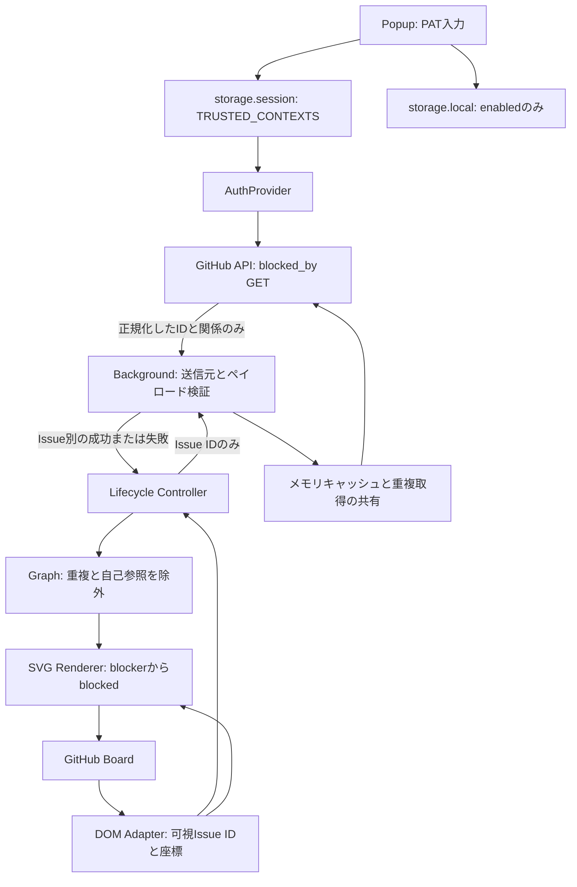

# ADR-001: 認証境界、取得範囲と DOM 統合

状態: 採用 / 日付: 2026-10-17

## 背景

Private Issue の依存関係を既存の GitHub Projects 上で表示する必要がある。ページに PAT を渡さず、GitHub の非公開 DOM の変更が認証処理や描画ロジックへ波及しない構造にする。

## 選択肢と決定

| 論点 | 選択肢 | 採用と理由 |
| --- | --- | --- |
| 認証 | PAT / GitHub App | MVP は期限付き Fine-grained PAT。App の導入・サーバーはスコープ外。API は AuthProvider のみに依存させ、交換可能にする。 |
| 保存 | グローバル変数 / local / session | `storage.session` の TRUSTED_CONTEXTS。Worker の停止をまたいで維持し、ディスクへの永続保存を避ける。 |
| 取得 | blocked_by / blocking / 本文解析 | `blocked_by` の GET。Fine-grained PAT の Issues read 対応が公式仕様にある。自由記述解析はしない。 |
| DOM | クラス推測 / 汎用リンクから推測 / 明示的Adapter | 明示的な Board と Card 境界を要求し、Issue URL で ID を取得する。構造が曖昧なら除外する。 |
| 監視 | ページ全体のみ / ルート分離 | グローバルはルート探索と URL 変化検知、Board ごとは Mutation/Resize。SPA 遷移時に Board 監視を解除し、探索監視を張り直す。 |
| 再取得 | DOM 更新ごと / 自動ポーリング / 手動Refresh | 新規 Issue と明示更新に限定。座標更新は描画だけを行い、Background に成功結果 TTL と進行中リクエスト共有を置く。 |
| 描画 | ページ要素の変更 / SVG overlay | 閉じた Shadow DOM 内の SVG。位置は viewport 座標、Board の表示範囲でクリップ、pointer-events:none。 |
| Rate Limit | 即時再試行 / Worker メモリのみ / セッション待機期限 | 待機期限をセッションに保存。Worker 再起動や Refresh で制限を無視しない。無限再試行を避け、手動復旧する。 |

## データフロー

## 境界

Domain は Chrome API に依存しない。Content は Fetch も PAT 読み取りも行わない。Renderer は Board のセレクタを持たない。Background は固定 API のみを公開し、任意 URL は受け付けない。設定変更は逐次処理し、認証・設定の変更時は進行中 Fetch を abort する。古い世代の取得結果をキャッシュや表示へ戻さない。

Board 自体とカードが見えるかを毎フレーム必要時に再評価する。描画時の Shadow DOM 更新と Overlay ホストの追加・削除は MutationObserver の再処理から除外する。未知の構造を認識済みとして扱わない。ページ全体の SPA 監視は OFF 時も残し、Board の監視と Overlay は OFF 時に解放する。ページ破棄時は監視・リスナー・タイマー・rAF を解除する。

## 帰結

関係取得範囲は可視 Issue の blocked_by に限られる。Board 外や仮想化されているカードへの辺は描かない。単一 PAT の権限外 Issue は部分エラーになる。GitHub の DOM 変更後は Adapter の実機検証と Fixture 更新が必要になる。自動ポーリングは行わないため、依存関係変更の反映は Refresh が必要である。

# ADR-002: 実 Board の DnD 属性を使った検出

状態: 採用 / 日付: 2026-10-17

## 背景

実際の非公開 GitHub Project を確認した結果、最初の Fixture で使った `data-testid` は存在しなかった。一方、Board ルートとカードに DnD 用の属性があり、カードの Issue URL は `role="button"` のリンクに残っていた。Table と Board は `project-items-region` という同じ ID を使っていた。

## 選択肢と決定

ID 単独やハッシュ付き CSS クラスによる検出は、Table の誤検出やクラス変更の影響があるため採用しない。実機で確認した `#project-items-region[data-dnd-drop-id="board"][data-dnd-drop-type="column"]` を Board とし、その中の `[data-board-card-id]` をカード境界とする。Issue ID は引き続き `a[href]` の URL から抽出する。仮想化されたカードの aria-label に Repository と番号が含まれていても、URL がないカードの識別や座標推測には使わない。

## 帰結

DOM の監視対象属性へ DnD 属性・カード ID・role・aria-disabled を追加する。実 DOM と同じ属性を持つ匿名化 Fixture で Table 除外・仮想化・再表示を自動検証する。これらの属性も GitHub の内部実装であるため、将来の DOM 変更時には再確認する。

# ADR-003: 設定通知の待機を制限する

状態: 採用 / 日付: 2026-10-17

## 背景

Dia で PAT 設定が完了せず、保存済みの認証情報を持ちながら Popup が応答を待ち続けた。Background の設定操作は全 GitHub タブへの通知を await しており、同時に凍結済みタブを確認した。

## 選択肢と決定

全タブからの応答を無制限に待つ方式は、表示していないタブで現在の認証操作まで止まるため採用しない。通知を完全に待たず送る方式は、設定変更の順序管理を別途必要とするため採用しない。凍結・破棄済みのタブを除外し、残る通知は最大1秒で打ち切る。認証・設定の変更は従来どおり逐次処理し、操作応答を有限時間で返す。

## 帰結

表示されていなかったタブへの即時反映は必須にせず、visibilitychange と focus で設定を再取得する。Chrome の frozen 属性が利用できない場合やタブ状態が通知直前に変わった場合も、待機の上限で現在の Popup を保護する。

# ADR-004: レーン分散と可視グラフの最長経路

状態: 採用 / 日付: 2026-10-19

## 背景

同じ列に複数の依存が並ぶと、カード中心を接続する曲線が重なり、別の関係が1本に見える。また、接続線だけでは依存の深さや分岐・合流を判断しにくい。

## 選択肢と決定

| 論点 | 選択肢 | 決定と理由 |
| --- | --- | --- |
| 重複する線 | 色だけを変更 / 線をずらす / カードの位置を変更 | 同列の線は左右のガターへ分離し、共有カードのポートを分散する。ボードのレイアウトを維持し、番号と関係一覧から個別に強調できるようにする。 |
| クリティカルパス | 工数を重みとする経路 / 依存辺数の最長経路 | 利用者が選択した、表示中のカード間の最長依存段数を採用する。期間・工数を取得せず、UIにも辺数であることを明示する。 |
| 複数の最長経路 | 1本だけを選択 / 同長経路すべて | 最大深さと下流の最大深さから、すべての最長経路に含まれる辺・ノードを強調する。 |
| 循環依存 | 無視 / 一部を切断 / 計算を無効化 | 実際に循環するノード・辺を検出し、赤い破線と警告を表示する。循環時は深さ・最長経路を未算出にして、切断による任意の順位を表示しない。 |
| 複雑さ | 単一の独自スコア / 観測できる数値 | 最長段数・分岐数・合流数、ノードごとの入出次数・重複なしの下流影響数を表示する。独自の重み付けや閾値は導入しない。 |
| 解析の範囲 | Project 全体の取得 / 表示カードのみ | 既存の取得範囲と読み取り権限を維持し、可視カード間のみを解析する。取得中・部分失敗・上限超過を明示する。 |

## 帰結

Domain は DOM に依存しない純粋な解析を行う。Renderer はノード・関係の変更時だけ解析を、位置の変更時だけ経路計算を更新する。同列のレーンは入力順に依存せず、カードと Board の境界を考慮して選ぶ。余白不足ではレーンを圧縮し、解析パネルから個別関係を確認できることを案内する。

解析パネルだけにポインター操作を許可し、線とバッジはカードのクリック・ドラッグを遮らない。パネルは折りたためる。番号は現在の関係集合を識別するもので、関係の追加・削除後も同じ番号を保証するものではない。グラフと描画だけの変更で追加の API や認証権限を要求しない。

# ADR-005: Chrome 配布を検証済みの GitHub Artifact / Release へ分離

状態: 採用 / 日付: 2026-10-19

ソース ZIP を展開しても Chrome に直接読み込めないため、型検査・単体・拡張統合テストに成功したビルドの `dist/` を GitHub Actions Artifact として保存する。バージョンタグでは同じ検証後、ZIP と SHA-256 を Release へ公開する。Artifact には保存期限とログイン要件があるため、恒久配布には Release の添付ファイルも提供する。

ZIP の直下に manifest.json を配置し、許可した実行ファイルだけを含める。ソースマップ・認証情報らしい値・想定外のファイル・シンボリックリンクはパッケージ処理で拒否する。実行に必要な npm 依存やサーバーは追加しない。Chrome Web Store の審査・更新基盤は今回の配布範囲に含めない。
