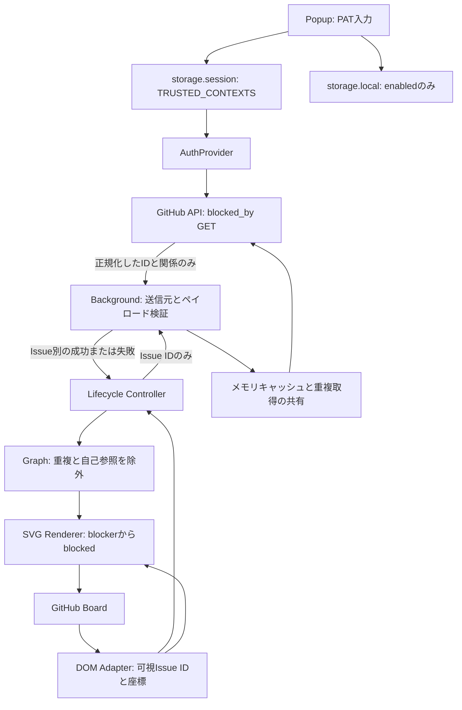

# ADR-001: 認証境界、取得範囲と DOM 統合

状態: 採用 / 日付: 2026-10-17

## 背景

Private Issue の依存関係を既存の GitHub Projects 上で表示する必要がある。ページに PAT を渡さず、GitHub の非公開 DOM の変更が認証処理や描画ロジックへ波及しない構造にする。

## 選択肢と決定

| 論点 | 選択肢 | 採用と理由 |
| --- | --- | --- |
| 認証 | PAT / GitHub App | MVP は期限付き Fine-grained PAT。App の導入・サーバーはスコープ外。API は AuthProvider のみに依存させ、交換可能にする。 |
| 保存 | グローバル変数 / local / session | `storage.session` の TRUSTED_CONTEXTS。Worker の停止をまたいで維持し、ディスクへの永続保存を避ける。 |
| 取得 | blocked_by / blocking / 本文解析 | `blocked_by` の GET。Fine-grained PAT の Issues read 対応が公式仕様にある。自由記述解析はしない。 |
| DOM | クラス推測 / 汎用リンクから推測 / 明示的Adapter | 明示的な Board と Card 境界を要求し、Issue URL で ID を取得する。構造が曖昧なら除外する。 |
| 監視 | ページ全体のみ / ルート分離 | グローバルはルート探索と URL 変化検知、Board ごとは Mutation/Resize。SPA 遷移時に Board 監視を解除し、探索監視を張り直す。 |
| 再取得 | DOM 更新ごと / 自動ポーリング / 手動Refresh | 新規 Issue と明示更新に限定。座標更新は描画だけを行い、Background に成功結果 TTL と進行中リクエスト共有を置く。 |
| 描画 | ページ要素の変更 / SVG overlay | 閉じた Shadow DOM 内の SVG。位置は viewport 座標、Board の表示範囲でクリップ、pointer-events:none。 |
| Rate Limit | 即時再試行 / Worker メモリのみ / セッション待機期限 | 待機期限をセッションに保存。Worker 再起動や Refresh で制限を無視しない。無限再試行を避け、手動復旧する。 |

## データフロー

## 境界

Domain は Chrome API に依存しない。Content は Fetch も PAT 読み取りも行わない。Renderer は Board のセレクタを持たない。Background は固定 API のみを公開し、任意 URL は受け付けない。設定変更は逐次処理し、認証・設定の変更時は進行中 Fetch を abort する。古い世代の取得結果をキャッシュや表示へ戻さない。

Board 自体とカードが見えるかを毎フレーム必要時に再評価する。描画時の Shadow DOM 更新と Overlay ホストの追加・削除は MutationObserver の再処理から除外する。未知の構造を認識済みとして扱わない。ページ全体の SPA 監視は OFF 時も残し、Board の監視と Overlay は OFF 時に解放する。ページ破棄時は監視・リスナー・タイマー・rAF を解除する。

## 帰結

関係取得範囲は可視 Issue の blocked_by に限られる。Board 外や仮想化されているカードへの辺は描かない。単一 PAT の権限外 Issue は部分エラーになる。GitHub の DOM 変更後は Adapter の実機検証と Fixture 更新が必要になる。自動ポーリングは行わないため、依存関係変更の反映は Refresh が必要である。

# ADR-002: 実 Board の DnD 属性を使った検出

状態: 採用 / 日付: 2026-10-17

## 背景

実際の非公開 GitHub Project を確認した結果、最初の Fixture で使った `data-testid` は存在しなかった。一方、Board ルートとカードに DnD 用の属性があり、カードの Issue URL は `role="button"` のリンクに残っていた。Table と Board は `project-items-region` という同じ ID を使っていた。

## 選択肢と決定

ID 単独やハッシュ付き CSS クラスによる検出は、Table の誤検出やクラス変更の影響があるため採用しない。実機で確認した `#project-items-region[data-dnd-drop-id="board"][data-dnd-drop-type="column"]` を Board とし、その中の `[data-board-card-id]` をカード境界とする。Issue ID は引き続き `a[href]` の URL から抽出する。仮想化されたカードの aria-label に Repository と番号が含まれていても、URL がないカードの識別や座標推測には使わない。

## 帰結

DOM の監視対象属性へ DnD 属性・カード ID・role・aria-disabled を追加する。実 DOM と同じ属性を持つ匿名化 Fixture で Table 除外・仮想化・再表示を自動検証する。これらの属性も GitHub の内部実装であるため、将来の DOM 変更時には再確認する。

# ADR-003: 設定通知の待機を制限する

状態: 採用 / 日付: 2026-10-17

## 背景

Dia で PAT 設定が完了せず、保存済みの認証情報を持ちながら Popup が応答を待ち続けた。Background の設定操作は全 GitHub タブへの通知を await しており、同時に凍結済みタブを確認した。

## 選択肢と決定

全タブからの応答を無制限に待つ方式は、表示していないタブで現在の認証操作まで止まるため採用しない。通知を完全に待たず送る方式は、設定変更の順序管理を別途必要とするため採用しない。凍結・破棄済みのタブを除外し、残る通知は最大1秒で打ち切る。認証・設定の変更は従来どおり逐次処理し、操作応答を有限時間で返す。

## 帰結

表示されていなかったタブへの即時反映は必須にせず、visibilitychange と focus で設定を再取得する。Chrome の frozen 属性が利用できない場合やタブ状態が通知直前に変わった場合も、待機の上限で現在の Popup を保護する。

# ADR-004: レーン分散と可視グラフの最長経路

状態: 採用 / 日付: 2026-10-19

## 背景

同じ列に複数の依存が並ぶと、カード中心を接続する曲線が重なり、別の関係が1本に見える。また、接続線だけでは依存の深さや分岐・合流を判断しにくい。

## 選択肢と決定

| 論点 | 選択肢 | 決定と理由 |
| --- | --- | --- |
| 重複する線 | 色だけを変更 / 線をずらす / カードの位置を変更 | 同列の線は左右のガターへ分離し、共有カードのポートを分散する。ボードのレイアウトを維持し、番号と関係一覧から個別に強調できるようにする。 |
| クリティカルパス | 工数を重みとする経路 / 依存辺数の最長経路 | 利用者が選択した、表示中のカード間の最長依存段数を採用する。期間・工数を取得せず、UIにも辺数であることを明示する。 |
| 複数の最長経路 | 1本だけを選択 / 同長経路すべて | 最大深さと下流の最大深さから、すべての最長経路に含まれる辺・ノードを強調する。 |
| 循環依存 | 無視 / 一部を切断 / 計算を無効化 | 実際に循環するノード・辺を検出し、赤い破線と警告を表示する。循環時は深さ・最長経路を未算出にして、切断による任意の順位を表示しない。 |
| 複雑さ | 単一の独自スコア / 観測できる数値 | 最長段数・分岐数・合流数、ノードごとの入出次数・重複なしの下流影響数を表示する。独自の重み付けや閾値は導入しない。 |
| 解析の範囲 | Project 全体の取得 / 表示カードのみ | 既存の取得範囲と読み取り権限を維持し、可視カード間のみを解析する。取得中・部分失敗・上限超過を明示する。 |

## 帰結

Domain は DOM に依存しない純粋な解析を行う。Renderer はノード・関係の変更時だけ解析を、位置の変更時だけ経路計算を更新する。同列のレーンは入力順に依存せず、カードと Board の境界を考慮して選ぶ。余白不足ではレーンを圧縮し、解析パネルから個別関係を確認できることを案内する。

解析パネルだけにポインター操作を許可し、線とバッジはカードのクリック・ドラッグを遮らない。パネルは折りたためる。番号は現在の関係集合を識別するもので、関係の追加・削除後も同じ番号を保証するものではない。グラフと描画だけの変更で追加の API や認証権限を要求しない。

# ADR-005: Chrome 配布を検証済みの GitHub Artifact / Release へ分離

状態: 採用 / 日付: 2026-10-19

ソース ZIP を展開しても Chrome に直接読み込めないため、型検査・単体・拡張統合テストに成功したビルドの `dist/` を GitHub Actions Artifact として保存する。バージョンタグでは同じ検証後、ZIP と SHA-256 を Release へ公開する。Artifact には保存期限とログイン要件があるため、恒久配布には Release の添付ファイルも提供する。

ZIP の直下に manifest.json を配置し、許可した実行ファイルだけを含める。ソースマップ・認証情報らしい値・想定外のファイル・シンボリックリンクはパッケージ処理で拒否する。実行に必要な npm 依存やサーバーは追加しない。Chrome Web Store の審査・更新基盤は今回の配布範囲に含めない。

# ADR-006: Table / Roadmap の行とタイムラインを接続する

状態: 採用 / 日付: 2026-10-19。ADR-001 / 002 の Board 限定の検出範囲を拡張する。

## 背景

同じ Project の Table / Roadmap でも依存関係を調べたい。View のルート ID は共通で、行の別フィールドにも Issue リンクが入るため、ルート ID や行内の全リンクだけでは接続先を特定できない。

## 選択肢と決定

| 論点 | 選択肢 | 決定と理由 |
| --- | --- | --- |
| 検出 | 汎用の Issue リンク / Project 内の既知構造 | Project URL に限定し、Table は grid 内の row / rowheader、Roadmap は literal の roadmap-row / roadmap-table-cell で検出する。 |
| Issue の特定 | 行全体 / タイトルセル | rowheader のリンクだけを使う。他の列にある別 Issue の参照を混同しない。 |
| Table の接続先 | 行全体 / タイトルセル | タイトルセルの矩形と左側のレーンを使う。他のフィールドを横断する線を減らす。 |
| Roadmap の接続先 | タイトルだけ / 日付から位置を推測 / 表示バー優先 | タイトルで Issue を確定し、同じ Issue URL の可視バーに接続する。バーがない・表示期間外・固定列に隠れている場合は、可視タイトルセルに接続する。 |
| 遮蔽 | 祖先の overflow だけ / 固定列とヘッダーも考慮 | Roadmap の sticky タイトル・日付列の右端と、sticky ヘッダーの下端を可視範囲に反映する。overscan で DOM に残る隠れた行へ接続しない。 |
| 数値の表示 | すべての行にバッジ / パネルに集約 | Board のバッジは維持し、狭い Table / Roadmap 行では項目選択から深さ・入出次数・下流の影響を表示する。 |
| 切り替え | DOM 要素だけで判定 / 要素と layout で判定 | 同じ root を再利用する View 切り替えでも監視と描画を更新する。経路キャッシュにも layout を含める。 |

## 根拠と帰結

GitHub の[公開 Project](https://github.com/orgs/github/projects/4247) が配信する [JavaScript の source map](https://github.githubassets.com/assets/memex-5f59d439a34fcfd4-f56c635816533e67.js.map) の TableCell / InteractiveItemTitle / RoadmapRow / RoadmapPill / RoadmapHeader の実装で、属性と Issue URL の対応を確認した。[公式 CSS](https://github.githubassets.com/assets/memex.e91539c9150e5d7b.module.css) で固定列・ヘッダーの sticky 配置も確認した。これらは内部実装であり、公開された互換性契約ではない。実装ソース自体は成果物に同梱しない。

合成データの Fixture で、タイトルとバーの一致・不一致、隠れたバー、日付なし、固定列の背後、ヘッダーの背後、他フィールドの参照、仮想化、View 切り替えを検証する。新たな API エンドポイント・認証権限は追加しない。解析対象と最長経路の定義は可視 Issue 間のままとする。

# ADR-007: PAT (classic) と SSO 認可エラーに対応する

状態: 採用 / 日付: 2026-10-19。ADR-001 の認証方式を拡張する。

## 背景

GitHub Enterprise Cloud の SSO 利用環境で、PAT (classic) の入力と認可手順が必要になった。従来は Popup と Background の入力検証が Fine-grained PAT の形式だけを受け付け、PAT (classic) を API 呼び出し前に拒否していた。API からの SSO 認可要求も一般的な権限不足として表示され、復旧手順を判断できなかった。

Fine-grained PAT 自体は SSO に対応し、トークン作成時に SSO 認可される。組織の管理者承認は別途必要になる場合がある。PAT (classic) は作成後の Configure SSO で対象組織への認可を行う。[GitHub の SSO 認可仕様](https://docs.github.com/en/enterprise-cloud@latest/authentication/authenticating-with-single-sign-on/authorizing-a-personal-access-token-for-use-with-single-sign-on) に従い、それぞれの手順を案内する。

## 選択肢と決定

| 論点 | 選択肢 | 決定と理由 |
| --- | --- | --- |
| トークン形式 | Fine-grained のみ / PAT (classic) も許可 / GitHub App へ移行 | `github_pat_` と `ghp_` の PAT を許可し、形式検証を Popup と Background で共用する。既存のセッション保存と API 呼び出しを維持して PAT (classic) を利用できるようにする。GitHub App の導入・サーバーは今回の変更範囲に含めない。 |
| SSO 認可エラー | 一般的な権限不足 / 専用エラー | 403 の `X-GitHub-SSO: required` を `SSO_REQUIRED` として返す。認可先 URL やレスポンス本文を Content Script に渡さず、Popup で Configure SSO と Refresh を案内する。 |
| 権限案内 | PAT を一律に案内 / 種類別に案内 | Fine-grained は対象組織・Repository・Issues: Read・管理者承認を案内する。非公開 Issue を取得する PAT (classic) は repo scope と SSO 認可を案内し、組織または Enterprise のポリシーで禁止されている場合は利用できないことを明示する。 |

## 帰結

Fine-grained PAT の利用を優先する。PAT (classic) の repo scope は書き込みを含む広い権限を持つため、拡張の読み取り専用動作とトークン自体の権限を区別する。[GitHub の PAT 管理仕様](https://docs.github.com/en/enterprise-cloud@latest/authentication/keeping-your-account-and-data-secure/managing-your-personal-access-tokens) と [scope 定義](https://docs.github.com/en/apps/oauth-apps/building-oauth-apps/scopes-for-oauth-apps#available-scopes) を根拠とする。

拡張は固定の依存関係取得 API への GET のみを送信し、PAT の保存先・Content Script との認証境界・認証変更時の取得中止を維持する。SSO の認可は GitHub の設定画面で利用者が行い、拡張内に IdP ログインや認可 URL を開く機能は追加しない。

# ADR-008: 依存線を Issue のペアと自然文で示す

状態: 採用 / 日付: 2026-10-19。ADR-004 の番号による依存線の識別を置き換える。

## 背景

匿名の番号を「関係 01」と表示しても、何の関係か、矢印のどちらが依存する側かを判別できなかった。線の番号を一覧と照合し、そこから Issue を探す操作も必要だった。

## 選択肢と決定

番号を残して説明文を増やす案は、一覧との照合をなくせず、具体的な依存の情報を見つけにくくするため採用しない。線には実際の Issue のペアを `#1 → #2` と表示し、初期表示で開く「依存の一覧」には `#2 は #1 に依存` と完全な Issue 識別子を併記する。可視範囲の Repository が単一なら `#番号`、複数なら `repo#番号`、異なる所有者の同名 Repository がある場合は `owner/repo#番号` を用い、線と一覧の表記を揃える。

一覧の選択で一本の線と両端カードのバッジを強調し、「強調を解除」で全体へ戻せるようにする。矢印の意味と依存の一覧を先に示し、深さ・分岐・合流の数値と説明は「深さ・分岐・合流の詳細」にまとめて折りたたむ。

矢印ラベルは Issue のペアを上段、両端の依存の深さを下段の `深さ 0 → 2` として表示する。単一の辺の順位を別途定義せず、カードと同じ 0 起点の最長経路による深さを前提・後続の順に示す。一覧と選択中の表示にも同じ値を含め、循環がある場合は `深さ 未算出` とする。

## 帰結

線とバッジは引き続き `pointer-events:none` とし、操作を解析パネル内に限定して既存カードのクリック・ドラッグを維持する。閉じた Shadow DOM、可視 Issue のみの解析、取得する API と認証権限は変更しない。Issue の完了状態から待機数や開始可否を推測せず、取得した依存の向きを示す。

# ADR-009: 依存・親子を Projects の標準フィルターとフィールドへ統合する

状態: 採用 / 日付: 2026-10-19。ADR-001 の読み取り専用 API、ADR-008 の解析パネル内だけの操作という制約を拡張する。

## 背景

依存・親子関係を Projects 内で編集し、他の項目と同じフィルター・表示設定で扱う必要がある。親子には既存の Parent issue / Sub-issue progress とセル編集がある。依存には標準の `is:blocked` / `is:blocking` / `blocked-by:` / `blocking:` フィルターがあるが、標準の依存フィールドはない。

## 選択肢と決定

| 論点 | 選択肢 | 決定と理由 |
| --- | --- | --- |
| 絞り込み | 可視 DOM を非表示にする / GitHub の標準クエリ | 標準フィルターバーに条件を追加する。非表示や仮想化された Issue も GitHub が判定し、通常の View 保存を利用できる。既存 OR 条件の意味を保つ。 |
| 親子の表示 | 独自の親子カスタムフィールド / 標準フィールド | 標準の Parent issue / Sub-issue progress を再利用する。値は Issue 関係 API または GitHub の標準セルで編集する。 |
| 依存の表示 | DOM だけの擬似列 / Project の実カスタムフィールド | Text の Dependency blockers / Dependency blocking と Single select の Dependency status に同期する。通常の列選択・並べ替え・選択値のグループ化を利用する。ミラーセルの編集を関係の変更と解釈しない。 |
| 編集 | ミラーセルから暗黙の逆同期 / 専用の明示操作 | カード・行の Relationships から固定 REST API で追加・削除する。文字列編集による関係の意図しない消去を避ける。親を自動置換しない。 |
| 同期範囲 | 可視 Issue / Project 全体 | 非アーカイブの Issue をページネーションで取得する。全件の列挙が終わるまで書き込まず、1,000 Issue 超過時は開始しない。関係の取得失敗を None に変換しない。 |
| 同名フィールド | 名前だけで再利用 / 作成 ID の所有権を記録 | 拡張が作成した ID だけを `storage.local` に記録する。型不一致・他者の同名フィールドを競合として拒否する。途中の作成成功後にも ID を保存し、再実行で重複作成しない。 |
| 更新の契機 | 定期的な全件同期 / 明示同期と編集後の差分更新 | 全件同期は利用者の操作時だけ行う。拡張での編集後は所有済みフィールドの両端を更新する。外部での変更は再同期する。 |

## 境界と帰結

表示を ON にしても自動で GitHub へ書き込まない。同期は読取専用のプレビュー後に実行し、対象 Project・Issue 件数・作成列・表示列を示す。Board・Table の明示的な View 番号がある場合だけ、既存の表示列を維持して列を追加する。Roadmap と View 未指定の URL では表示設定を自動変更しない。filter・sort・group は変更しない。

関係の編集には Issues: Write、標準フィールドの同期には Projects: Write が追加で必要になる。PAT と任意クエリは Content Script に公開しない。Background のメッセージ検証で Project・View を送信元と照合し、固定クエリ・固定 REST 操作だけを提供する。関係・同期の書き込みは順序を制御し、認証変更前に待機していた書き込みを新しい認証で実行しない。長い同期の間も Logout による中断を妨げない。

API で成功した変更を自動でロールバックしない。Issue の変更が成功してミラーの更新が失敗した場合は、変更成功と同期失敗を区別する。GraphQL の部分エラーは成功扱いせず、変更結果が未確認の項目を表示する。再試行は自動で行わない。

拡張 UI は閉じた Shadow DOM に置き、所有属性を MutationObserver の除外に追加する。破棄・SPA 遷移・View 切り替えで UI を除去する。Board の Issue 識別から標準 Fields 領域と拡張所有 UI を除き、関係先リンクをタイトルと混同しない。

## 根拠

[公開 Project](https://github.com/orgs/github/projects/4247) の[公式配信 source map](https://github.githubassets.com/assets/memex-1088950f07fae620-9ca0ff903e7899a2.js.map)で、依存 provider の標準フィルター登録、親子のセル編集、既存フィールド、`filterQuery` の読込経路を確認した。依存 qualifier の値は[共有 filter provider の source map](https://github.githubassets.com/assets/jc-46c0fcfd65f80a0d-9f798fd0ce60aaf7.js.map) の `nwoReference` に従う。これらは GitHub 内部実装の確認であり、DOM の互換性契約ではない。

書き込みは公開の[依存 REST API](https://docs.github.com/en/rest/issues/issue-dependencies?apiVersion=2026-03-10)、[親子 REST API](https://docs.github.com/en/rest/issues/sub-issues?apiVersion=2026-03-10)、[Projects GraphQL API](https://docs.github.com/en/graphql/reference/projects)を使う。実アカウントの Issue や Project を変更する検証は自動テストに含めない。
